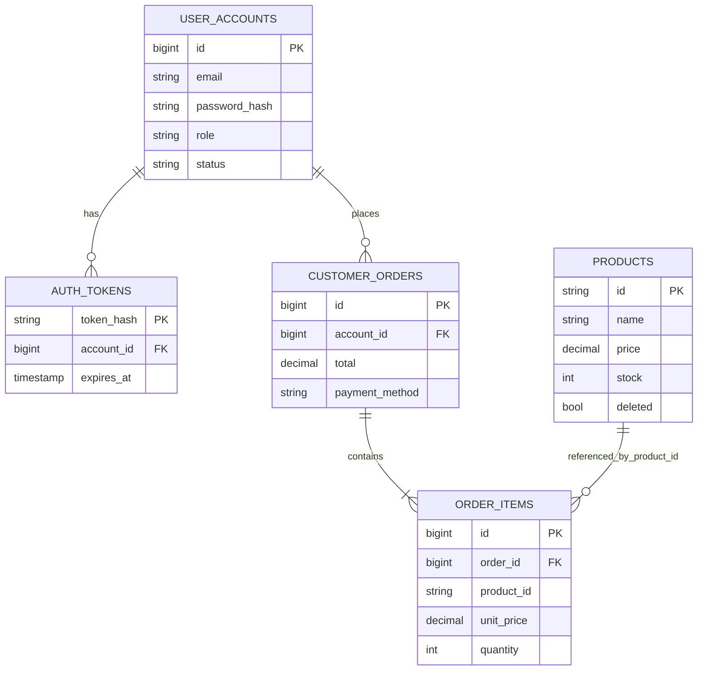

# Lumière Beauty — React + Spring Boot 4 + PostgreSQL

This project contains the **original React frontend with its pages connected** to a new Java Spring Boot 4.0.9 REST backend. PostgreSQL stores products, users, authentication sessions, orders, and order items. pgAdmin is used to manage the PostgreSQL database (it is not the database itself).

**Start here:** [STEP_BY_STEP_SETUP.md](STEP_BY_STEP_SETUP.md)

## Project folders

```text
lumiere-fullstack/
├── frontend/             React 18 + Vite 6 + Tailwind 3 + Axios
│   ├── src/services/api.js
│   ├── src/context/AuthContext.jsx
│   ├── src/context/ShopContext.jsx
│   ├── src/pages/           Shop, Login, Checkout, My Orders, Admin
│   └── .env.example
├── backend/              Spring Boot 4.0.9 + Java 17+ + Spring Security + JPA
│   ├── pom.xml
│   └── src/main/java/com/lumiere/beauty/
│       ├── model/       Product, UserAccount, AuthToken, CustomerOrder, OrderItem
│       ├── repo/        Spring Data JPA repositories
│       ├── api/         REST controllers, validation, error responses
│       ├── security/    BCrypt passwords, access token, admin authorization
│       └── config/      Sample products + first admin account
└── STEP_BY_STEP_SETUP.md
```

## API quick reference

| Method | Path | Who can use it |
|---|---|---|
| GET | `/api/products` | Public (Active only); admin sees Active and Draft |
| GET | `/api/products/{id}` | Public for Active; admin for all |
| GET | `/api/brands` | Public |
| GET | `/api/categories` | Public |
| POST | `/api/auth/register` | Public, creates Customer only |
| POST | `/api/auth/login` | Public |
| GET | `/api/auth/me` | Signed in |
| POST | `/api/auth/logout` | Signed in |
| POST | `/api/products` | Admin |
| PUT | `/api/products/{id}` | Admin |
| DELETE | `/api/products/{id}` | Admin (soft delete) |
| GET | `/api/orders/my` | Signed in; own orders only |
| POST | `/api/orders` | Signed in |
| GET | `/api/admin/orders` | Admin |
| GET | `/api/admin/users` | Admin |
| POST | `/api/admin/users` | Admin |
| PATCH | `/api/admin/users/{id}` | Admin |
| DELETE | `/api/admin/users/{id}` | Admin, if no prior orders |

## Database table relationships



Order item `product_id` is an intentionally denormalized snapshot reference rather than a DB foreign key, so a deleted product does not destroy past order history. Order pricing and stock are verified by the backend in one transaction. The cart is **local to the browser** until checkout (and no cart table exists yet).

## Security and scope

- Registration only grants **Customer** role. The first **Admin** is created via `APP_ADMIN_EMAIL` and `APP_ADMIN_PASSWORD` environment variables; admins may create other accounts in the protected admin UI.
- Passwords are BCrypt hashed; access tokens expire after 7 days, are SHA-256 hashed in PostgreSQL and are revoked on logout or when account role/status changes.
- React stores the bearer token in localStorage for **local training only**. For production, migrate to secure HttpOnly cookies/session design, HTTPS, CSRF protection, rate-limiting, audit logs, migrations (Flyway), automated tests, and secure secret management.
- Stock decrements when the order is **placed**, not when paid; no payment gateway, automatic shipping fees, refunds, emails, image upload, or backend cart syncing are implemented.
- Product deletion is logical (`deleted = true`). You can still inspect the row in pgAdmin.
- Local development only: `spring.jpa.hibernate.ddl-auto=update` auto-creates/updates tables. Don't use this in production.

